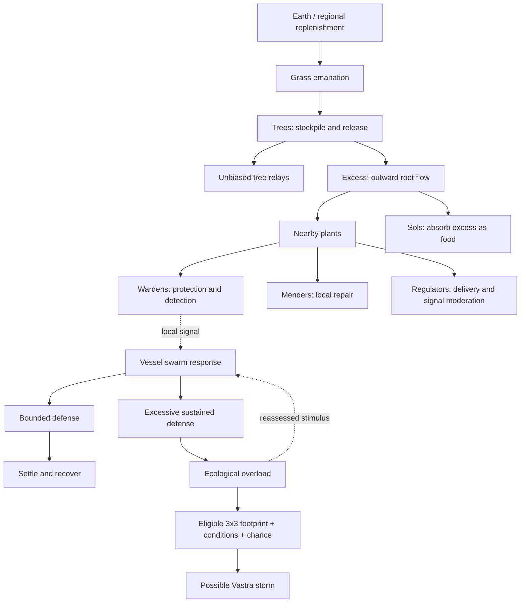

# SolHunter living-world concept report

This concept report predates the map-first launch. Its proposed habitats and ecology remain design input. See the [map-first game](../README.md#play-the-map-first-build).

October 29, 2026. Consolidated from the owner's vision discussion and questionnaires.
Status: conceptual report, not an implementation specification or completion claim.

Latest design: [section 14](#14-vegetation-signals-and-vessel-response) supersedes
earlier cue-only Vessel scope and related unresolved functional questions.

## Purpose and authority

The immediate problem is that the world contains trees, props and creatures but
does not have enough happening within it. More scenery or Sol movement alone
will not solve that. Roads and wilderness should feel alive even without Sols.

The owner is away from home and has explicitly requested conceptual work for now.
This report consolidates ideas; it does not authorize implementation of every
proposal. Confirmed directions below mean explicit answers in this discussion,
not approval of unexamined mechanics or amendments to every Bible section.

The [Bible](reference/SolHunter_Worldbuilding_Bible.md) remains design authority;
[PROJECT_STANDARD](PROJECT_STANDARD.md) governs workflow. The
[world/exploration roadmap](world-exploration-roadmap.md) owns delivery sequencing.
Before implementing non-generation mechanics, consult the source and evidence
required by [mechanics reference](mechanics-reference.md). This report has not
performed that reconciliation for the new concepts. Godot remains generation
authority. Preserve existing combat, collection, companions and persistence.

## 1. Confirmed creative direction

### Overall experience

- Exploration, understanding Sols and resolving local situations should reinforce
  one another; the owner selected all as reasons to return.
- Interchangeable places are the clearest identified weakness.
- The painterly world should be mostly welcoming, with danger localized.
- Unusual places and Vastra clues should reward detours.
- Distinct travel habits should help companions feel individual.
- Observation should provide useful behavioral understanding, leads to other
  places and personal journal memories. Specific triggers/rewards remain open.
- Revisiting should uncover another layer of discovery.
- Ecological consequences should include occasional major focal moments.
- Optional clues and local leads suit campaign-free play.
- A future owner review should judge whether a local event makes the player care.

### Immediate focus

- Focus on Vastra, world generation and biome-specific systems.
- Establish nature functioning without people or negative human interference
  first, so later interference has a clear baseline for comparison.
- Prioritize nature, sound and dynamic weather; no people in this first phase.
- Start with meadow and woodland.
- Mix watchable activity with opportunities to interact.
- Use multiple pacing templates: quiet stretches, frequent small details and
  concentrated interest. The owner did not select one universal event frequency.
- Unusual Vastra should invite a decision: approach, avoid or interact.
- Revisits retain familiar place identity while presenting different activity.

Natural variation must remain distinct from ecological damage. Neither ordinary
weather nor an unusual-looking Vastra feature automatically establishes overload.

## 2. The game-loop context

Earlier inspection found existing foundations for encounter, capture, party/storage,
leveling, training, refuge recovery and saves. Those are not newly missing systems.
The identified connection gap was what motivates the next expedition after the
initial waystone-and-return objective ends.

Earlier proposals were optional leads, useful discoveries, a local interaction
with a remembered outcome, clearer progression goals and a satisfying refuge
return. The owner then pivoted toward making the world worth watching and exploring
before adding more leads. These earlier proposals remain future connections,
not the immediate work queue. Campaign delivery and Thor optimization remain
deferred under existing direction.

Proposed experiential loop:

**Notice activity -> investigate a place -> observe or participate -> understand
something or leave an outcome -> return to a familiar place with different activity.**

This describes experience, not a new reward formula or quest system.

## 3. Four layers of a living environment

The following is the proposed organizing framework:

| Layer | Contribution | Examples |
| --- | --- | --- |
| Continuous activity | Physical presence | Wind in vegetation, moving water, changing sound |
| Local identity | Activity belongs to this place | Exposed meadow versus sheltered woodland |
| Occasional happenings | Change during a visit | A shower, a strong gust, a natural gathering |
| Lasting traces | A place exists beyond the visit | Worn approaches, natural disturbance, saved event aftermath |

Continuous motion alone can become background. Happenings need conditions,
readable signs and endings. Quiet periods are useful; constant effects would
weaken atmosphere and make important cues harder to recognize.

Human examples discussed earlier included travelers, work near shelters, roadside
exchanges, worked ground and abandoned belongings. These are deferred examples,
superseded for the first phase by the owner's explicit nature-first choice.

## 4. Geography and biome framework

Proposed composition sequence:

**Geographic region -> landform/water context -> biome -> local site/patch -> detail.**

Regions provide broad character; landforms create enclosure, exposure, shelter
and reveals; water context shapes banks and wet ground; biomes provide structure
and responses; local patches create clearings, thickets and openings. Details
reinforce those decisions. Roads can pass through enclosure, opening, bend and
reveal while retaining reliable access.

Rendering chunks do not own geographic identity. Generation should admit a
landmark where its requirements fit or omit it, rather than force unsafe access.

### Candidate biome treatments

These examples are proposals, not final biome rules:

| Biome | Spatial character | Activity candidates |
| --- | --- | --- |
| Meadow: first scope | Open views, irregular grass patches, grove edges | Traveling wind fronts, flower/grass response, passing cloud light, Vessel groups |
| Woodland: first scope | Canopy enclosure, layered undergrowth, root hollows and clearings | Crown movement above sheltered plants, creaks, falling leaves, shifting light, Vessel resting/gathering |
| Heath: later | Exposed shoulders, low scrub and rock interruptions | Pronounced wind, scrub movement and readable approaching weather |
| Marsh: later | Pools, reeds and narrow dry approaches | Reed/ripple activity, rain on water and localized water sound |

Specific environmental proposals discussed:

- Meadow wind fronts make approaching gusts visible across vegetation.
- Weather transitions change light, vegetation response and sound.
- Woodland layers reveal crown activity above sheltered ground vegetation.
- Water-edge activity belongs to real water and current weather. Connected streams
  are generation work; drainage analysis alone is not a flowing river network.
- Local sound sources reward locating water, a creaking tree or Vessel activity.
- Vastra convergence can make a natural opening worth investigating.
- Familiar sites present different calm, windy, rainy and nighttime experiences.

Taking shelter was proposed as an activity, but no protection benefit, hazard,
movement penalty or resource requirement has been approved by this discussion.

## 5. Weather, sound and Vastra

Reuse the approved [weather hierarchy](weather-roadmap.md): shared weather owns
conditions/transitions, wind owns airflow/gusts, geography modifies exposure and
presentation consumes the result. Day/night remains alongside weather. A breeze
should produce related responses rather than independent effects everywhere.

Plants retain different flexibility; clouds can respond more slowly. Audio should
have identifiable sources and appropriate spatial character under existing mix
and voice budgets. Missing suitable licensed cues remain missing slots, not
permission to invent inaccurate sound sources.

Vastra should provide presence, coherent activity and natural points of interest.
Build on the [current world-anchored presentation](vastra-visual-roadmap.md), whose
owner art acceptance remains separate from technical checks. Proposed convergence
sites include root openings and rock gaps. Keep concentration, overload and visual
revelation distinct. Weather-to-Vastra coupling is not automatically approved.

The owner wants decisions around unusual Vastra. What makes avoidance worthwhile,
which interactions exist and whether any phenomenon is hazardous remain open.
Uncertainty and an interesting appearance do not establish damage mechanics.

## 6. Vessels: small Vastra-born wildlife

### Owner-established concept

Small wildlife need not be Sols. They come from and run on Vastra, can serve as
vessels of Vastra and act as an intermediary in cueing systems. The owner selected
**Vessels** as their placeholder name. Particle-system wildlife is the proposed
presentation direction; the term is not final taxonomy.

### Proposed functional role

**Existing local conditions -> Vessel response -> player interpretation.**

Candidates include meadow swarms gathering near vegetation, woodland groups
settling near leaves/roots, sheltering from wind or rain, and changed movement
around unusual Vastra. None is yet an approved spawning or ecological rule.

Recognizable gather/settle/scatter/return behavior should matter more than tiny
visual detail. Give biomes different forms, occupied spaces and habits. Include
ordinary activity so every gathering does not become a guaranteed reward marker.
Resting and low-visibility periods can prevent constant glitter.

Conceptual implementation proposal: particle/batched rendering supported by a
lightweight group or habitat controller. Rendering does not itself own ecological
state. Per-creature saves are not assumed; persistence granularity remains open.

### Unresolved boundaries

- What distinguishes Vessels from Sols biologically and magically?
- Are forms persistent, temporary, intelligent or individually recognizable?
- What creates, sustains and disperses a group?
- Do they merely reveal conditions or actually transport/transform energy?
- Can players touch, disturb or otherwise interact with them?
- Which cues can players learn reliably?

The suggestion that Vessels are temporary while Sols have enduring identities was
an assistant proposal, not owner-approved canon. Actual energy transfer,
concentration changes and plant replenishment require separate mechanics work.
Earlier suggestions of butterflies, insects and birds must now be reconciled with
the Vessel concept rather than assumed to be ordinary real-world animal species.

## 7. Landmark framework

### Owner-established direction

- Mix authored landmarks with generated variations.
- Major landmarks combine recognizable terrain, lore and event potential.
- Natural history and an unexplained past can both inform them.
- Favor environmental interpretation and mystery over explicit explanation.
- Smaller ambient activity remains present between events.
- Weather, time, local Vastra and Vessel activity condition events.
- Some events unfold independently; consequential cases need deliberate handling.
- Player participation can lead to different outcomes.
- Signs should be recognizable while retaining surprise.

Always-present ambient activity means a living baseline, not nonstop spectacle.
Its intensity can vary with conditions while the place retains identity.

### Proposed ownership

| Component | Responsibility |
| --- | --- |
| Landmark definition | Identity, composition and suitable terrain |
| Generated site | Stable location, orientation, boundaries and approaches |
| Lore clues | Observable evidence and approved meaning |
| Activity/event definitions | Compatible situations and eligibility |
| Saved outcomes | Actual discoveries, choices and lasting changes |

A landmark exists independently of an event. Scenery unloading must not erase
its identity or restart consequential activity. Events reference weather, Vastra
and ecology owners rather than creating parallel simulation authorities.

### Lore and terrain

Terrain formation, evidence of history and present activity should reinforce one
another. A road bending toward a site, fitted foundations or vegetation around
old structures can suggest history more effectively than a randomly placed ruin.
Human structures are later possibilities, not the first phase's required content.

Distinguish observable facts, possible interpretations and confirmed knowledge.
An unexplained formation can raise a question without an immediate answer.
Journal presentation should not silently turn speculation into canon.

### Candidate natural landmarks

- Split-stone passage: a recognizable opening frames a view and unusual Vastra.
- Ancient root hollow: enclosure, sound and Vessel activity distinguish woodland.
- Meadow basin: vegetation and weather reveal a recognizable depression.
- Exposed ridge: orientation, wind and approaching weather become readable.

These are assistant proposals. Their exact lore and rules remain unapproved.

## 8. Landmark events inspired by the owner's examples

The owner offered ideas of Sols gathering to heal a wounded ally, Sols jumping
through a wormhole to another location for fun, territorial Sols and Sol dens.
The owner explicitly described these as ideas rather than concrete designs.

| Proposed family | Quiet identity | Event possibility | Participation possibilities |
| --- | --- | --- | --- |
| Sanctuary | Sheltered hollow, resting places, Vessel activity | Sols gather around a wounded ally | Watch, give space, help caregivers or potentially help the injured Sol |
| Passage | Strange natural formation with unusual Vastra | Playful Sol travel through a temporary opening | Observe, investigate or potentially follow |
| Territory | Readable boundaries around valued space | A resident warns an approaching player | Withdraw, observe or choose another approach |
| Den | Persistent home, entrances and worn approaches | Residents return, gather or respond to disturbance | Observe outside or investigate under defined conditions |

Sanctuary was recommended as an emotionally readable first event, not selected by
the owner yet. Tending, guarding and actual healing are different capabilities.
A den is a home; territorial behavior is one possible relationship to its space.
Do not assume every den is aggressive, permanently occupied or player-accessible.

The wormhole needs special clarification: literal traversable connection,
Sol-only phenomenon, or a visual impression imply different lore, travel and
generation commitments. No portal mechanic is approved. The idea of playful
behavior is valuable even before choosing its explanation.

These Sol-centered landmark examples complement the environment-first work;
they do not replace the requirement that a place feel alive when Sols are absent.

## 9. Event lifecycle and reusable authoring sheet

Proposed lifecycle:

**Eligible -> readable signs -> active situation -> resolution -> aftermath/rest.**

For each event, specify suitable conditions, placement, participation, departure,
nonparticipation, recurrence and persistence. Watching is a valid possibility;
arriving or leaving must not silently commit a player choice. Independent activity
and protected consequential opportunities need case-by-case design. Different
participation outcomes do not automatically require permanent terrain changes.

| Authoring field | Question |
| --- | --- |
| Identity | What makes the place recognizable? |
| Terrain fit | Where can it belong, and when should admission fail? |
| Approach | How is it noticed and safely reached? |
| Quiet state | What ambient activity exists between events? |
| Evidence | What is observable, inferred and confirmed? |
| Conditions | What permits or prevents activity? |
| Signs | What can an attentive player learn to recognize? |
| Participation | What actions or observations matter? |
| Absence | What happens without the player or after departure? |
| Aftermath | What changes, persists or returns to normal? |
| Variation | What can vary without losing identity? |
| Limits | How are repetition, density and effects bounded? |

## 10. Landmark asset work and its current boundary

The owner requested additional placeholder assets to support focal locations.
Twenty-five Kenney CC0 models were selected from Fantasy Town, Graveyard and
Castle kits. Model import/loading checks passed; provenance and original licenses
are in the [landmark library](../assets/landmarks/PROVENANCE.md).

Ingredients include carts/stalls, a fountain, arches/broken walls, tower/bridge
parts, stone columns and an obelisk. Some suggested compositions require assembly;
windmill/watermill assets are mechanism pieces, not complete buildings. Source
pack names do not establish SolHunter lore. Models have not been placed in the
main world or accepted for visual fit, collision or interactions.

Physical placement remains on hold. Conceptual landmark planning has resumed at
the owner's request. These are distinct: discussing sites does not resume asset
rollout or override nature-first scope.

## 11. Proposed delivery plan after conceptual work

No implementation begins solely because this report exists.

| Step | Deliverable | Review gate |
| --- | --- | --- |
| 1. Define healthy nature | Meadow/woodland experience sheets and Vessel boundaries | Clear natural baseline with no human interference |
| 2. Select a connected sample | Existing road through two habitats; baseline walk/watch record | Identify concrete failures; preserve normal gameplay |
| 3. Establish shared motion | Weather/wind, vegetation and appropriate audio responses | Surroundings agree; pause/reload/streaming remain coherent |
| 4. Integrate Vastra and Vessels | Approved look and a bounded biome-specific activity study | Readable local behavior without assumed energy-transfer mechanics |
| 5. Compose natural focal sites | One site per biome, quiet-state activity and lore evidence | Distinct places worth approaching without active events |
| 6. Specify one situation | Eligibility, signs, participation, absence and aftermath | Reconciled rules and deliberate outcomes before coding |
| 7. Review and expand | Normal-input revisit; additional seeds after the first proof | Familiar identity, changing activity and controlled repetition |

The earlier execution outline proposed reviewing Vastra first, then shared weather
and biome motion. Practical work should reuse current progress rather than rebuild
systems. The above sequence clarifies dependencies after the Vessel/landmark
discussion; it is a proposal, not a replacement feature roadmap.

Relevant owners: [weather](weather-roadmap.md),
[Vastra visuals](vastra-visual-roadmap.md), [terrain](terrain-roadmap.md),
[biome/geography](biome-encounters-geography.md), [audio](audio-framework.md),
and [Sol behavior](sol-behavior-roadmap.md).

## 12. Experience acceptance and open decisions

When the owner is home, judge the connected result by these questions:

- While standing still, what are the surroundings doing without nearby Sols?
- Are meadow and woodland recognizable through structure, motion and sound?
- Does something invite attention without a marker?
- Do activities fit their place and conditions?
- Do Vessels feel alive, and are their cues understandable without becoming guarantees?
- Does Vastra belong to the landscape and offer a meaningful decision?
- Is a landmark interesting between events?
- On return, is the place familiar but its activity different?
- Do consequential situations handle participation and absence fairly?
- Are quiet periods preserved, and does repetition remain tolerable?

Later implementation checks must cover relevant access, stable identities,
current-format save/load, replay-safe outcomes, bounded activity, streaming and
desktop performance. Automated success does not establish experience acceptance.

Next conceptual decisions: define Vessel lifecycle/cue boundaries; author meadow
and woodland sheets; select natural landmark examples; clarify the sanctuary's
player role; classify the passage idea; specify event persistence and recurrence.
No production rates, hazards, rewards, healing formulas, portal rules or full
ecosystem simulation have been established by this conversation.

## 13. First delivery: healthy-nature experience sheets

October 29, 2026. World-roadmap step 0 authoring deliverable. These sheets are
reviewable proposals under the approved direction, not approved new canon or a
runtime implementation. They narrow the first study without settling the open
mechanics in sections 6–9. No new SolHunterSource reconciliation is claimed.

### Meadow: exposed basin and grove edge

The road crosses an open shoulder before curving along a shallow grassy basin.
An irregular grove edge frames the woodland ahead. The basin is a dry landform
candidate, not a new pond or implied river. Keep a clear view along the road and
an optional approach on player-scalable ground; omit the focal treatment if the
existing geography cannot support both.

In calm conditions, the composition carries the scene: uneven grass masses,
open ground and a few flower patches leave breathing space. In a breeze, a broad
response passes through grass before reaching the grove edge. Stems and crowns
respond with different flexibility to shared wind, rather than separate random
gusts. Passing cloud light changes the apparent depth of the basin. Rain uses
the shared weather presentation; it grants no shelter benefit or travel penalty.

Sound should convey exposure through the existing weather bed and assigned
vegetation cues. Do not add a constant insect/bird loop as an assumed wildlife
taxonomy. Unassigned cues remain silent. A quiet road stretch precedes the basin;
the grass response is the small detail, and the framed depression is the focal
moment. Vessels are a later optional cue study, not needed to make this baseline
active.

On return, the basin outline, road bend and grove edge remain recognizable.
Weather, light and vegetation motion may differ. A changed visit does not require
a new landmark layout, collectible or journal reward.

### Woodland: sheltered floor beneath an active canopy

The same road enters an irregular canopy edge, then passes a shallow clearing.
Use understory clusters and gaps to reveal depth while keeping the road and
interaction targets readable. Enclosure comes from trunks, crowns and terrain;
do not close required access with roots or decorative collision.

The defining contrast is moving crowns above a quieter forest floor. After
shared wind works, geographic shelter can reduce local exposure smoothly.
Clearings admit more motion and changing light than protected undergrowth.
Calm remains visibly calm. Sparse falling-leaf accents are optional, cover-bound
polish; they must not become perpetual leaf showers or imply damage. Rain and
cloud response consume the same conditions as the meadow.

Use an assigned spatial creak or foliage cue only where a suitable source exists,
under the current audio budget. The canopy must establish woodland character
even when no new licensed sound is available. An enclosed quiet stretch leads
to the clearing; its light opening supplies the focal contrast. The environment
must remain watchable with no Sol or Vessel in frame.

On return, the opening, trunk groups and road approach remain stable while light
and motion vary. No den occupancy, healing, territorial response or event
recurrence is inferred from that variation.

### Candidate natural landmarks

These are two candidates for later site admission and review, not selected
production landmarks. Neither uses the downloaded landmark-model library.

| Field | Meadow: wind basin | Woodland: root-window clearing |
| --- | --- | --- |
| Identity | Shallow asymmetric depression framed by an exposed shoulder and grove edge | A root-framed opening beside a clearing, with a view through to deeper woodland |
| Terrain fit | Existing dry basin or shoulder with gentle access; reject wet ground or forced excavation | Existing grove edge with adequate root clearance and stable ground; reject blocked roads or buried openings |
| Approach | Road reveals the depression obliquely; optional walk reaches its rim without a jump | Road reveals the opening between trunks; optional approach ends outside the root structure |
| Quiet activity | Grass responds across the depression; cloud light reveals its shape | Crown movement, sheltered groundcover and changing clearing light |
| Observable evidence | Depression, vegetation bands, exposed and sheltered patches | Root shapes, enclosure, light gap and differences in vegetation motion |
| Interpretation only | The shape may suggest a history of wind or water; no geological cause is confirmed | The opening may feel old or significant; no ancient inhabitant or ritual is established |
| Possible later conditions | Shared wind/light state; local Vastra and Vessel cues only after their contracts are specified | Shared weather/time; local Vastra and Vessel cues only after their contracts are specified |
| Event boundary | No reward, hazard, gathering or arrival trigger is assigned | No sanctuary, den, portal or healing effect is assigned |
| Safe variation | Basin proportions, framing vegetation and orientation within admitted access | Opening orientation, framing trunks and understory within admitted clearance |

No new lore fact is confirmed by either candidate. Existing secluded ancient-grove
healing canon remains separate; this root-window candidate does not instantiate
that campaign location or convert it into a wounded-ally event.

### Vessel cue and lifecycle boundary for the later pilot

The bounded proposal is to compare one meadow group occupying open vegetation
with one woodland group occupying sheltered foliage. Gather, settle, scatter and
return are presentation candidates to evaluate, not a biological lifecycle.
Neither group is required in the first weather/scenery baseline.

| Boundary | First-study treatment | Decision still open |
| --- | --- | --- |
| Cue meaning | Show observable movement and occupied space; permit an ordinary gathering with no special destination | Which conditions reliably predict each response, and how players learn that meaning |
| Vastra | Consume an approved local reading if a later cue contract needs it | Actual transport, consumption, replenishment and relation to Sol biology |
| Lifecycle | Describe visible activity states only | Birth, lifespan, death, intelligence and dispersal causes |
| Continuity | Rendering cannot decide ecological facts; visual disappearance proves no death or departure | Group versus individual identity, offscreen activity and save granularity |
| Interaction | Observation through ordinary travel; no new action or reward is specified | Touch, disturbance, following, capture or other participation |
| Limits | Reuse effects budgets; preserve quiet areas and readable road/target silhouettes | Density, timing and visibility tuning after an actual pilot exists |

Until these questions are reconciled, the pilot must not write ecological state,
change Vastra concentration, promise a discoverable reward or treat unloading as
an event outcome. No spawn rates, timers or save schema are proposed here.

### Evidence and next gate

| Classification | Evidence and implication |
| --- | --- |
| Approved creative direction | Bible: owner-approved living environments, Vessels and landmarks; supports nature-first meadow/woodland, changing activity and stable place identity |
| Existing generation/access contract | [Biome/geography](biome-encounters-geography.md): captured geography, final-terrain road admission and independent rendering boundaries; candidate sites must fit these owners |
| Planned presentation contract | [Weather WX0–WX4](weather-roadmap.md#delivery-sequence): shared saved-clock wind, consumer migration and later shelter; these sheets do not claim it is implemented |
| Existing mechanics evidence | Biome/geography records source commit `115f3e87acc1716c7113523567c01e1666681885` for habitat admission and retained Sol identity; it establishes no Vessel or landmark-event rule |
| Proposed, unreconciled mechanics | Vessel lifecycle, reliable cues, energy transfer and event participation/absence/recurrence remain open; inspect actual source, callers, tests and decisions before specifying them |

Step 0's authoring deliverable is complete; owner concept acceptance remains
open. The next runtime task is step 1: select an actual normal-game road across
the two habitats, record seed/settings/source fingerprints, and capture outbound,
return and stationary baseline evidence. The three proposed comparisons are
coherent environmental motion, recognizable habitat structure and landscape-readable
Vastra. Record observed failures before treating those as confirmed priorities.
If the generated route cannot support the proposed basin/root-window treatments,
adapt or omit the candidates rather than reroll unrelated geography.

## 14. Vegetation, signals and Vessel response

October 29, 2026. Owner-authorized refinement including player communication.
Bible remains authority; this design is not runtime delivery or final balance.
It supersedes earlier cue-only Vessel scope; biological questions remain open.

### System layout

Layout combines retained energy concepts and planned relationships, not every
transfer route. Swarm feeding debits a real source; signals cannot create energy.
Preserve reserve cap 100, separate root/in-flight accounts and Sol feeding.

### Plant classes

Growth form owns anatomy/habitat, circulation role supply/storage, class specialist
function, and species its particular expression. Keep affinity independent. One
primary class per specialist species; ordinary flora may be unclassed.

| Class | First function | Limit | Visible expression |
| --- | --- | --- | --- |
| Warden | Detect local disruption; spend energy limiting incoming overload spread | Finite protection, no immunity or global knowledge | Brief localized activity; defensive swarm gathering |
| Mender | Spend energy reducing existing positive local overload | No initial regrowth, Sol HP healing or universal cleansing | Incoming energy consumed locally; less onward release during repair |
| Regulator | Moderate its own exchange cadence and repeated signal propagation | Conserves energy; cannot erase real warnings or cancel direct ability effects | Measured deliveries and gradual settling |

Bound overlapping benefits. Avoid a mandatory three-class recipe. Preserve natural
baseline recovery; migrate generic repair deliberately. Nursery/regrowth remains
deferred. New plant-to-plant routes require explicit authoring. Information never
reroutes tree transfers toward need. Supply remains region-bounded.

### Signals and swarm behavior

Start with one disturbance trace: original event identity, origin, observation
time and expiry. Relays preserve original expiry; duplicates cannot renew alarms.
Bound reach, memory and recruitment. Remote traces prompt investigation; local
defense/repair checks local conditions. Signals convey no intention or unseen
instigator. Energy, concentration, overload and affinity stay separate.

The swarm is the first simulation unit: stable group identity, location, accounted
reserve, state and bounded remembered events. Visible member count cannot multiply
capacity. This settles no individual lifespan, consciousness or birth/death rule.
Resident and traveling habits are initial variants; splitting/merging is deferred.

| State | Activity | Exit / limit |
| --- | --- | --- |
| Ordinary | Feed, rest, circulate | Encountered cue or valid trace prompts investigation |
| Investigating | Some lead; neighbors follow and sample the area | Return when expired or unwarranted |
| Responding | Gather and perform authored energy-paid defense | Finite recruitment/duration; stop when stimulus subsides |
| Escalating | Excessive sustained defensive activity adds bounded overload | Reassess locally; same alarm cannot renew indefinitely |
| Recovering | Decompress, settle, resume ordinary activity | Recovery interval limits immediate retrigger; fresh events need defined handling |

A natural disturbance triggers response without directly causing overload. Only
explicit excessive defensive activity is this new overload source. Natural trigger
candidates require real ecological state and a specified detector, not wind/leaf
animation or concentration alone. Begin with a declared fixture disturbance; author
a natural cause before production natural-storm claims. Bound escalation even
without Regulators. Storm admission still requires the existing 3x3 footprint,
conditions, probability and protected-access rules. Admission differs from storm
scheduling/effects; storm onset does not reset overload. No harvesting, calming
action, player attack or reward is established here.

### Player communication: world, Observe and Details

Motion/spatial organization comes first, restrained sound second, text supplies
clarity. Preserve affinity colors. Readability cannot rely on color or sound alone.
Quiet is healthy. All surfaces read the same authoritative activity.

| State | World cues to prototype | Example Observe wording |
| --- | --- | --- |
| Ordinary | Loose circulation, settled members, short journeys | A loose swarm moves between the grass and nearby roots. |
| Investigating | A few lead; neighbors progressively turn | Small groups keep turning toward the disturbed patch. |
| Responding | Local gathering, purposeful passes | The swarm gathers around this patch, releasing short pulses. |
| Escalating | Repeated discharges, abrupt compression, widening affected area | Repeated discharges spread beyond the patch. The swarm shows little sign of settling. |
| Recovering | Fewer discharges, wider gaps, settling members | The swarm is spreading out and settling among the leaves. |

Examples require matching actual behavior; these are not final strings.
Observe retains its short appearance/behavior format. Unfamiliar species receive
visible descriptions; recognized species can add learned function. Mark inference
separately: "Its behavior suggests a defensive response." Learning persistence is
future work, not a new mastery meter. An idle Mender cannot be described as healing;
no visible strand does not prove depleted reserves. Details holds available exact
local readings, reserves and active functions with unknowns/scope explicit. No
remote scan or storm certainty is implied. Actual danger needs a direct readable
warning beyond ambient effects; brightness alone is not authoritative hazard.

Use a stable swarm-group target, not individual particle picking. Reuse existing
Observe/Details context interactions with controller equivalence when delivered.
Check target readability against foliage in daylight/darkness. Menu reads cannot
reset responses or generate energy. Art, sounds and picking geometry need a real
connected study. Do not add a global alarm feed.

### Source evidence and implementation boundary

Read-only local SolHunterSource HEAD names `development/world-redesign-0.2`; its
ref file reads `d6f0902d77ed46a2f7d251c354792a4cc9210bc4`. Working-tree cleanliness
was not verified; this identifies the ref, not file equality. Inspected Vastra
storage/simulation/recovery, `src/core/game.py` activity caller,
`src/systems/world/storms.py`, focused storm-check searches,
`tests/test_storm_checks.py`, focused foundation-test searches and the regional
equilibrium audit. Admission rejects concentration-only, missing/protected,
recovered and disallowed cases; conditions and chance remain required.
Inspected `storms.py` SHA256:
`118c3e56d2aa21f8d80d487228950ca2ab43690d9a461949a3875dbc2cd21482`.
No small Vastra-wildlife immune system was found in the targeted search. Vessel
overload is an owner-directed extension. No source files were copied/edited;
source tests were read, not executed.

Current Godot circulation does not establish plant classes, signals, Vessel
simulation or procedural storms. Retain bounded geographic service and no invented
inactive/offline refill until deliberately changed. Save group state, expiry,
energy and outcomes independently of camera/streaming. Shared active clock keeps
unrelated world activity running during tactical combat; explicit pause stops it.
Any schema change follows existing compatibility policy. Runtime acceptance and
balance remain open; sequencing belongs in the world roadmap.
