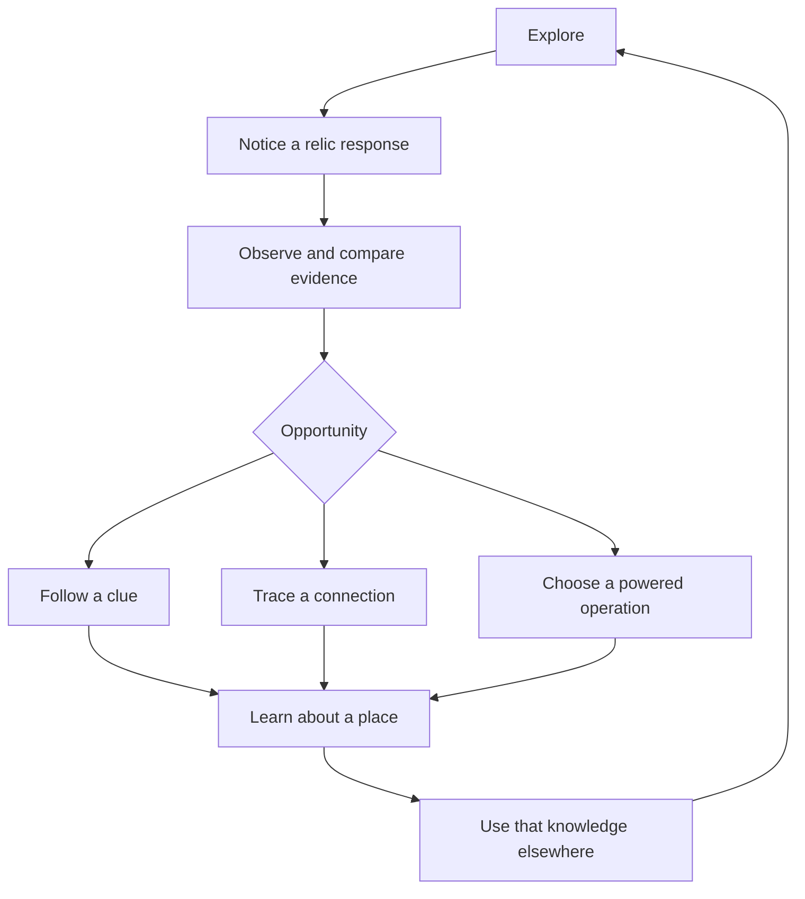

# Relic structures: gameplay and delivery plan

## Approved roles and optional nature integration — October 31, 2026

Owner approved different relic types for information reveal, energy redirection
and local structure operation. They receive actual local ambient/plant/relic
connections according to authored design. Reactions and recurring carved motifs
teach function; the existing journal records discoveries. Broad roles and source
families are no longer unanswered proposals. Exact operations, source-access
budgets, motifs, repair, rewards and prices still need authoring. Lab supplies and
12/20/16 costs below remain synthetic, not production acceptance.

The [nature-only loop](world-exploration-roadmap.md#nature-delivery-sequence)
does not depend on powered relics. R0-R3 can supply an optional discovery; R4-R5
remain a later connected operation slice. Do not block three natural discoveries,
safe rest or companion cooperation on relic machinery. No NPC, quest turn-in,
portal, fast travel or generic loot container is implied by these approvals.

Update R0's site sheet with a recurring motif, actual observed reaction, useful
information/optional destination, a quiet-state clue and journal finding. R3 must
use N2 durable knowledge, not the recent sightings eviction list. R4 source intake
must debit a real authored source and preserve plant recipient rules; full-node,
in-flight, unload/retry and operation expenditure remain conserved. Ambient intake
requires its allocation policy; real connection does not mean unlimited extraction.
R5 authors the local operation before it spends energy. Existing black stone,
90-degree recesses and real crevice flow remain the art contract.

Acceptance: understand a motif at another site, discover from either approach,
leave/return and save/load without duplicated findings or effects. Revealed
destinations remain optional and physically accessible. Broad downloaded-asset
placement remains held; original admitted structures retain their own review.

Prepared October 30, 2026. Status: isolated lab prototype and feature roadmap;
no expedition integration or owner playtest acceptance is claimed. This document
owns relic feature delivery and acceptance.
[World/exploration](world-exploration-roadmap.md) owns cross-feature priority,
[PROJECT_STANDARD.md](PROJECT_STANDARD.md) owns workflow, and the
[Bible](reference/SolHunter_Worldbuilding_Bible.md) governs canon.

Creative preview follow-up, October 30: **Development Lab → Creative additions →
Creative additions / relics** now hosts an original-geometry visual study with
three silhouettes, purpose captions and independent synthetic concentration and
signed-condition controls. It is partial R1 presentation exploration, not the
shared runtime catalog, a reconciled powered mechanic or R3 gameplay completion.
See [workstation usage](development-workstation.md#creative-additions--october-30-2026).

Procedural follow-up: the preview now consumes
`scripts/scenery/procedural_relic.gd`, a reusable seeded visual-layout and stone-mesh
builder. Seed, scale, missing stonework and rubble are tunable in the lab, with a
New design action. Structural and detail streams are separate. This extends the
R1 visual study; catalog admission, world spawning, collisions and powered behavior
remain subsequent milestones. It does not establish a live world generator.

## Direction and boundaries

Owner follow-ups, October 30: relics can take in Vastra and output something
according to their purpose. Every relic needs a consistent node, with several
visual styles. Vastra should run through veins mapped along relic crevices.
The four supplied images guide silhouette development; they do not establish
portals, levitation, historical builders or universal green affinity.

The lab now has seven procedural families, three stone materials and three node
carving profiles. A shared `VastraNode` scene preserves logical `Core`, `InputPort`,
`OutputPort` and `PurposeOutput`. Generation version 5 supplies bounded, seeded input/output
polylines connected to those fixed anchors, with fracture variation around grammar
joints. These are authored procedural routes, not automatic crevice detection on
arbitrary imported meshes. Traveling energy follows those same routes.

Owner refinement: the relics must look ancient and less technological. Crevices are
angled indents in the stone, not separate objects. `relic_carving.gd` projects route
contacts onto admitted stones and subdivides/displaces their vertices inward for
square-bottomed cuts with 90-degree walls and recessed seals. The existing maps remain the fine surface
detail. Glow is masked to those recesses on the same stone mesh. Raised cylinders,
metal-like node frames, port collars, the central orb and in-world technical labels
were removed; logical connection and energy accounting remain. New socket profiles
replace the earlier ringed/prismatic/caged housing study.
The owner subsequently selected ambientCG Rock051 as the relic surface. All three
material variants now share its authored maps; only tint differs. Earlier rock and
masonry candidates remain on disk with provenance but no longer supply relic bodies.

Latest owner direction: make the relics ominous black stone, use hard 90-degree
etch-outs, and broaden missing-layer range/variation. The lab now uses three black
Rock051 tints, cooler lighting and restrained Vastra light. Geometry clipping builds
flat cut floors and perpendicular boundary walls in the owning stone mesh. Etch
depth is adjustable (0.04–0.12 m). Missing stonework spans 0–2, course count 2–12,
and uneven break variation 0–1, with a shared 160-piece ceiling. Different wall and
spire stacks retain different seeded heights; severe damage leaves low supported
remnants. These are visual-generation controls, not destruction or repair mechanics.

Lab-purpose resources define clue reveal, energy relay and layout reveal, with
provisional costs 12/20/16. Each fixture node starts with a finite external test
supply of 100, reserve cap 100, one inbound and one outbound packet. Departures
debit their source; arrivals credit reserve, receiver or expenditure once. A relay
keeps energy at its receiver; the two reveals spend energy to show local evidence.
These are test-purpose examples and do not approve production rewards or harvesting.
Rebuilding resets this test circuit; only draft tuning is saved by the workstation.

Production work still requires geographic admission, an authored sustainable energy
source, expedition-owned transactions, saved mid-flight state and atomic outcomes.
No plant/root recipients, regional harvest budgets or expedition saves were changed.
Foundation evidence is the pinned SolHunterSource lookup below and the Godot
conserved plant/root contract; the owner's new direction supplies relic intake/output.

Confirmed owner direction from this chat: plan basic relic-like structures that
spawn in the world; follow a shared system like plants and Sols; relics react to
Vastra; focus their design on gameplay purpose.

Owner approval, October 31: different relic types reveal information, redirect
energy or operate local structures. Authored local connections supply ambient
flow, plant energy or energy from another relic. Observable reactions and recurring
carved motifs teach function, with discoveries recorded in the existing journal.
See the Bible's October 31 relic-purpose section. Specific source access, costs,
capacity, motifs and operations still require authoring; no runtime completion is
claimed. Resonator/conduit/reservoir names and marker/arch/foundation appearance
families remain working designs. Repair, rewards and numerical tuning remain
proposals. Requesting this
plan does not approve every example or establish ancient builders, consciousness,
portals, historical recordings, a global relic network or new Vastra origins.

The first deliverable is a bounded discovery prototype. Existing holds on
downloaded landmark assets remain; use original simple geometry for review.
Production rollout is a later milestone, not a new priority ahead of the living
environment work. Preserve campaign deferral, required access and existing plants,
Sols, weather and ecology authorities.

## Gameplay target

Relics give players reasons to notice, approach, interpret and revisit places.
Knowledge of a motif or reaction should help with later exploration. Small ruins
can finish their purpose in one visit; only selected sites need a longer loop.

| Role (proposed) | Player action | Useful result | Return reason |
| --- | --- | --- | --- |
| Resonator | Observe reactions; compare carvings with terrain and other relics. | Recognize a connection or discover an optional destination. | New evidence changes an earlier interpretation, or conditions change. |
| Conduit | Follow a real transfer; inspect an interruption or branch. | Understand why a site operates; restore a specifically authored connection. | A known remaining branch becomes relevant. |
| Reservoir | Read available charge, operation purpose and cost; choose an operation. | Reveal information or operate a local mechanism. | Another operation remains and its actual supply has replenished charge. |

Do not make every relic a mandatory puzzle or reward container. The first slice
uses information and an optional destination as its rewards. Inventory rewards,
stat bonuses, healing, fast travel, encounter guarantees and harvesting tools are
outside that slice. Specific later rewards need their own mechanics evidence.

## System ownership

Follow the existing resource/catalog/instance/state/presentation pattern. This
does not mean copying the plant schema or introducing relics as fake plants.
Inspect current plant and Sol definitions before implementing shared conventions.

| Owner | Responsibility |
| --- | --- |
| Relic definition and catalog | Unique type key; appearance family; functional profile; footprint, terrain and approach requirements; operation references; validation. |
| Geographic region and admitted site | Density/spacing budget; stable site identity; canonical cells; authored connections; reservations and safe access. Render chunks do not own placement. |
| Site modules and details | Share the site's geometry budget. Damage, rubble and material variation cannot reroll the site or allocate more energy stores. |
| Expedition state | Sole writer for saved discoveries, repairs, reserves, transfers and lasting operation outcomes where those features exist. Derived appearance is not another saved authority. |
| Existing Vastra/ecology owners | Local concentration, signed overload, plants, root stock, feeding and Vessel responses. Relics reference those owners. |
| Presentation and existing interaction UI | Show authoritative reactions and operation availability. Observe describes evidence; Details shows available readings. Rendering and menus cannot create charge or transfers. |

Suggested homes, created only as implemented: relic definition/catalog/site
helpers under `scripts/scenery/`, authored records under `resources/scenery/`,
visual consumers under `scripts/presentation/`, and expedition-owned state through
the current persistence boundary. Update the existing ownership and Inspector
indexes when code lands; do not create a parallel tuning or workflow standard.

## Vastra contract and reference evidence

Existing rules are recorded in [Vastra integration](vastra-integration.md),
[human activity](vastra-human-activity.md), and the Bible's plant circulation,
root overflow and vegetation/Vessel response sections.

Read-only reference inspected during this chat at SolHunterSource commit
`d6f0902d77ed46a2f7d251c354792a4cc9210bc4`:

- `src/systems/world/vastra.py`: detached inspection and independent concentration/overload state.
- `src/systems/world/vastra_simulation.py`: bounded regional replenishment; reads do not allocate state.
- `src/systems/world/vastra_human_activity.py`: shared regional harvest budgets, explicit excess consequences and replay-safe commands.
- `tests/test_vastra_foundation.py`: independence, read-only inspection, validated persistence and rollback coverage.

This is foundation evidence, not evidence of implemented relic mechanics or the
latest state of all source branches. Godot's later signed restoration and conserved
plant/root transactions remain binding. Follow [mechanics-reference.md](mechanics-reference.md)
for further operation, repair or energy-policy decisions and record exact evidence.

Required integration constraints:

- Concentration controls proposed response strength; overload has a distinct cue.
  High concentration is not automatically danger. Restorative conditions remain
  separate from reserve and do not automatically repair stone.
- Resonators read a bounded canonical local area without extracting energy or
  creating sparse environmental records. Missing data must not be fabricated as
  a known zero. Define the sampled cells and aggregation per response profile.
- Preserve affinity independently of structure family and function. Use existing
  affinity presentation; no new affinity mapping is established here.
- Powered endpoints need explicit support beyond the current plant/tree ledger.
  Each source debit, in-flight packet, recipient credit and operation expenditure
  must be accounted for. Credit exactly once and reserve incoming capacity.
- A relic reserve cannot exceed 100. Define a smaller capacity if useful, intake
  policy, full behavior, rejected-delivery handling and replenishment source before
  enabling an operation. Do not silently consume root stock or alter unbiased
  plant/tree recipient selection.
- Ambient intake needs an authored infrastructure policy using the existing
  regional budget/transaction boundary or a reconciled extension. No automatic
  excess-to-overload conversion or presumed ancient-infrastructure classification.
- Use the saved active clock. Pause/offline time, retry, camera movement, module
  count, unload and reload cannot grant energy or repeat operations. Preserve
  existing continuing-world behavior during combat.
- Living vegetation around ruins retains canonical flora registration. Relics
  cannot directly recruit Vessels, heal habitats or originate storms by proximity.

## Delivery sequence

### R0 — Author one complete discovery

Specify a small marker/arch/foundation group, its repeated motif, observable
evidence, optional destination and each member's standalone meaning. Label fact,
interpretation and learned function separately. Specify quiet, rich, disrupted
and restorative presentations; these are overlapping inputs, not a universal
linear relic lifecycle.

Deliverable: one site sheet with approach sketches, clue relationships and a
walkthrough in both directions. Resolve the powered source, repair method/cost,
operations and resource policy before implementing those later behaviors.
Until resolved, the complete resonator discovery remains independently playable.

Acceptance: the player has a useful observation at every member, can understand
the link from either direction, and needs no unsupported powers or lore claim.

### R1 — Build the shared definitions and isolated review fixture

Implement validated resources, catalog lookup, stable instance references and one
marker resonator. Host the fixture in the shared Development Lab with expedition
save/clock isolation. Supply presets for healthy rich, quiet, disrupted and
restorative conditions, plus sliders for connected numeric tuning, visible values
and switches/selectors for discrete options. Lab conditions stay out of saves.

Acceptance: one profile works on more than one appearance family; response changes
are readable without relying on color or audio alone; Observe and Details agree
with the fixture's authoritative inputs. No simulation write occurs on inspection.

### R2 — Prove sparse, deterministic placement

Extend the existing scenery-site admission/reservation pattern. Use geographic
parents and bounded searches; protect routes, spawn, existing sites, water,
clearings and slope limits. Reserve footprint, supported foundations, approaches
and any required sightline before dressing. Capture generation-affecting settings.

Linked discoveries require valid spatial relationships. Admit a complete viable
group, or use an explicitly authored standalone fallback with no dangling clue;
otherwise omit it. Stable site and group IDs survive chunk boundaries and load
order. Detail changes cannot move sites. Terrain generation remains authoritative.

Acceptance: repeatable placement across representative seeds and region boundaries,
no floating/buried foundations or blocked essential access, and no references to
missing group members. This phase proves generation, not production rollout.

### R3 — Deliver the first resonator-only exploration loop

Connect marker, arch and foundation reactions and clue content. Use the existing
context-action interface and controller equivalent; retain normal movement and
pause behavior. Observe is the safe default for initial relic encounters. Actions
with lasting effects must be explicit. Persist only genuinely authored discovery
state; do not add a new journal system just for this slice.

Acceptance: walk marker-first and foundation-first; follow the clue without a
mandatory quest marker; leave and return; save/load preserves discovered state;
the quiet version still offers evidence. Discovery is not gated solely on waiting
for a transient Vastra condition. Record a short normal-camera review.

### R4 — Add one real conduit and reservoir

After R0's powered specification is resolved, extend the expedition transaction
model with explicit relic endpoints. Implement one bounded source-to-reservoir
connection, an authored interruption/repair if retained, finite capacity and full
behavior. Reconcile source callers/tests/decision evidence for any new mechanic.
Expose actual connected rates and costs through validated Godot resources.

Acceptance: conservation including in-flight energy and spent energy; simultaneous
arrivals and full destinations; source/destination unavailability; atomic repair
and expenditure; repeated commands; mid-flight and mid-operation save/load;
pause/inactive behavior and bounded work. Define persistent operation state so
unloading cannot duplicate an effect or strand energy. Review one actual transfer.

### R5 — Add a local operation choice

Candidate operations: illuminate a carved layout, or move a surviving stone screen
to reveal a sightline toward an optional place. These remain examples until the
site sheet defines their exact effect. Show available energy, cost, expected
effect and disabled reason before expenditure. Insufficient charge spends nothing.
Define whether each operation is one-time or repeatable and what reset means.

Author a useful first choice, an alternate opportunity and the actual return
condition. Basic investigation remains available while waiting for charge.
Operations cannot trap the player, block essential routes or require repeated
visits without new information. Do not add generic loot or powers to supply value.

Acceptance: both operation orders work; outcome and debit commit together; retries
and reload cannot repeat one-time outcomes; the player can explain why they chose
an operation and why another visit might be useful.

### R6 — Review and expand deliberately

Review the connected slice in a normal expedition before enabling broader spawn
density. Record seed, settings, screenshots and player observations: what attracted
attention, what evidence was understood, what choice was made, and whether the
detour felt worthwhile. Check walking, standing, ordinary zoom, day/night and
weather visibility; use existing sound routing and accessibility conventions.

Only after that review add standalone sites and more definition-driven variations.
Each new site declares a purpose, evidence, access needs and optional return reason.
Do not require bespoke logic for every new mesh. Keep broad downloaded-asset rollout
separate from this original-geometry prototype.

## Verification and completion

Use existing scenery admission, flora/Vastra, persistence, interaction and rendered
journey coverage where applicable. Add focused tests for new contracts, not prose
or duplicated authored values. Run Godot import/parse and relevant checks when code
lands; generation/schema/shared transaction changes warrant broader integration
coverage under the project standard. Keep configured CI checks intact.

Documentation delivery is complete when this plan's links, ownership, proposed
status and whitespace are checked. Runtime milestones remain open. The first
gameplay milestone is R3: a sparse, understandable resonator discovery. The powered
milestone is R5: one conserved connection and a meaningful local operation choice.
Production acceptance remains R6; passing documentation checks proves neither.
