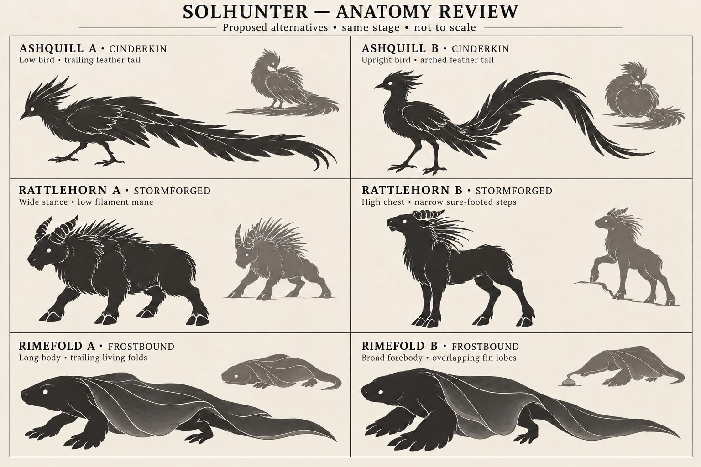

# Sol anatomy review — Ashquill, Rattlehorn and Rimefold

October 28, 2026. First design deliverable from the
[creature handoff](sol-creature-design-handoff.md). The owner requested that work
start; the alternatives below record the proposals and subsequent owner selection.
The [Sol Bible](reference/sol_bible.md) remains the roster index. Detailed anatomy
proposals live in the linked species sheets, rather than in a second roster.

## Review board

Owner feedback, October 28: **B selected for all three**, followed by the explicit
clarification that these are **small, cute first-stage creatures**. The board
looks closer to a final-stage direction and is not the first-form proportion
target. Preserve B's body plans while shortening/softening ornaments, increasing
facial appeal and keeping the bodies small. This does not approve final-stage
models, family counts or evolution conditions.



Each row compares alternatives for the same proposed early stage. These are not
evolution sequences or relative-size specifications. Large silhouettes show the
body plan; small silhouettes explore signature gestures. The image is generated
concept art, not an engine render, tested model, or exact rig specification.
Use the written sheets to resolve any ambiguous limb or appendage in the drawing.

| Candidate / approved class | Direction A | Direction B | Owner selection |
| --- | --- | --- | --- |
| [Ashquill / CinderKin](reference/sols/ashquill.md) | Low bird with trailing feather tail | Upright bird with arched feather tail | B, adapted to a downy first form |
| [Rattlehorn / Stormforged](reference/sols/rattlehorn.md) | Wide, low, heavy-chested quadruped | Higher chest and narrower, longer-legged stance | B, adapted to a rounder first form with tiny ring horns |
| [Rimefold / Frostbound](reference/sols/rimefold.md) | Long amphibian with trailing side folds | Broad forebody with overlapping fin lobes | B, adapted to a broad-faced first form with smaller lobes |

## Existing creatures considered together

The three integrated approved concepts have an actual rendered baseline:


The provisional legacy lineup has a separate actual rendered baseline:


These two images are existing local ignored review output. They are not newly
rendered acceptance evidence and may be absent in a fresh checkout. The anatomy
board above is kept with this review. Legacy models preserve identities without
approving those species for the final roster. The unassigned creature has no class.

| Creature / class | Silhouette and proportions | Supports, surface and gait | Comparison implication |
| --- | --- | --- | --- |
| Crown-Ear / Beast | Face-framing ears, small central body, wide wing span | Two hind feet and wing-wrist supports; membrane; ground scuttle and admitted low flight | Ashquill needs a projecting beak, clear two-foot stance and long feather tail; avoid bat wings or a circular facial crown |
| Reedback / Abyssal | Compact horizontal body, low head, stacked back | Four broad feet; overlapping plates; grounded travel and admitted surface swimming | Rimefold needs a longer soft body, broad front limbs and flexible lateral folds; avoid a plate stack |
| Bellroot / Bloom | Bell/bulb body with radial leaf crown | Four root contacts; living plant tissue; deliberate root steps | None of the new candidates should reuse a bulb with themed appendages |
| Ashquill / CinderKin | Low beaked bird and trailing tail (A), or upright chest and arched tail (B) | Two support legs; layered feathers; proposed alternating bird steps | Changes support count and head/body relation across the batch |
| Rattlehorn / Stormforged | Broad low chest (A), or elevated chest and tapered haunches (B) | Four cloven supports; ringed keratin and stiff filaments; proposed planted weight shifts | Distinguish from Bramblepup through chest mass, feet, short ring horns and mane, not recoloring |
| Rimefold / Frostbound | Long narrow trunk (A), or broad front tapering into a long rear (B) | Four supports with forelimb emphasis; soft overlapping fins; proposed low crawl | Soft wrapping sides must remain distinct from Reedback's rigid dorsal layers and Rillfin's fish tail |
| Seedmote / Bloom, provisional | Split seed husk, leaf arms and cotyledons | Two root supports; plant tissue; current procedural walking | Retains botanical class readability; not a production approval |
| Bramblepup / Beast, provisional | Long-backed hound, projecting muzzle and brush tail | Four supports; current procedural walking | Rattlehorn should not become a horned hound |
| Ashkit / CinderKin, provisional | Upright feline, free forepaws and ash ruff | Two supports; current procedural walking | Ashquill's avian head, folded wings and long tail must read without color |
| Rillfin / Abyssal, provisional | Low fish body, lateral fins and deep tail paddle | Short supports; current ground posing; no inferred swimming permission | Rimefold should read as a limbed amphibian with body-length wrapping tissue, not a fish recolor |
| Unknown / unassigned, provisional | Neutral articulated diagnostic body | Two supports; current procedural walking | Diagnostic fallback only; no inferred roster membership |

## Readability and production review

The initially recommended A/A/A combination changes support count (two versus four), overall
axis (tail-led bird, chest-led quadruped, elongated crawler), head/body relation
and surface structure. These differences survive loss of color. The owner-selected B alternatives
use a more vertical bird, a lighter quadruped and a broader finned amphibian.
Retain those body-plan differences as their juvenile proportions are refined.

Before detail work, review the silhouettes at expedition-camera size and from
front, side and three-quarter views. The current board is one-view concept work;
it does not pass that engine-camera check. Rattlehorn's ring gaps may disappear
at distance, so its braced chest and broken mane outline must carry recognition.
Rimefold's folds must wrap without looking like a hard shell. Ashquill's tail
must remain readable without requiring a large permanent effect.

Specific drawing limits to resolve in a blockout: Ashquill's crest should retain
soft down rather than the board's sharp feather tips; Rattlehorn's first-stage
horns must stay short despite the exaggerated ring outlines. Rimefold B's small
gesture does not clearly separate the reaching fin from the forefoot; the model
must show the fin moving independently while all four supports remain grounded.
The revised board improves membrane readability but does not settle these details.

With B selected, make distinct small, cute first-form workshop blockouts and
the eight required pose families (rest, alert, locomotion, turn, signature,
attack, hit and recovery). Verify contact chains and the full moving envelope
before catalog admission. Choose family structure before reserving later-form
slots. No runtime IDs, stats, moves, abilities or traversal policies are assigned
by this review. No new mechanics are proposed here; source reconciliation belongs
to the later gameplay specification, following the mechanics-reference procedure.

## Status and evidence

| Species | Candidate / concept | Anatomy | Blockout | Integrated | Owner model review |
| --- | --- | --- | --- | --- | --- |
| Crown-Ear | Approved concept | Existing pilot art remains provisional | Existing | Existing | Not established by this review |
| Reedback | Approved concept | Existing pilot art remains provisional | Existing | Existing | Not established by this review |
| Bellroot | Approved concept | Existing pilot art remains provisional | Existing | Existing | Not established by this review |
| Ashquill | Approved concept | B selected; small/cute first form | Articulated blockout | Normal game | Finished-art review pending |
| Rattlehorn | Approved concept | B selected; small/cute first form | Articulated blockout | Normal game | Finished-art review pending |
| Rimefold | Approved concept | B selected; small/cute first form | Articulated blockout | Normal game | Finished-art review pending |

New board provenance: generated with the built-in image-generation tool for this
review. [Saved prompt](reference/sols/anatomy_review_01_prompt.txt). No third-party
pack or existing franchise design was used as an input. This is design evidence;
it does not establish animation feasibility, geometry cost or AYN Thor acceptance.
The handoff's atmosphere-test failure remains unresolved by this design work.

Initial concept-only documentation verification: the four new Markdown sheets passed a scoped check
of fifteen local file links and trailing whitespace. The final board was visually
inspected and is approximately 2 MB. No game code or resources changed during that
initial concept-only slice. Subsequent blockout verification follows below.

## Selected first-form blockouts

Open the dedicated workshops with F6:
[Ashquill](../scenes/ashquill_workshop.tscn),
[Rattlehorn](../scenes/rattlehorn_workshop.tscn),
[Rimefold](../scenes/rimefold_workshop.tscn). These use distinct builders and actual
support chains: two bird legs; four narrower hoofed legs with a three-foot
signature; and four amphibian limbs with separate soft fin controls. All use a
provisional 0.65 art scale. Juvenile head/body proportions and reduced ornaments
carry the small/cute direction; scale reduction alone is not the design change.


G/J/H cue signature/attack/hit with recovery. M cycles exercises and Space pauses.
The eight essential pose families are supplied by the shared driver plus distinct
head/wing/tail, horn/mane/forefoot and fin gestures. These workshop instances have
no saved individual. The same scenes now also serve catalog records and normal
gameplay following the owner's apply instruction; see the integration below.

The new anatomy suite checks actual support counts, slope walking at 30/60/144
FPS and 0.3/1.33 m/s across 0.5/1/1.5 art scales, bounded geometry count, intrinsic
animation envelopes, turn/pause replay, affinity independence, three planted
supports during Rattlehorn's forefoot test and four during Rimefold's fin reach.
`tests/sol_anatomy_batch.gd` is included in the shared validator. Original
blockout geometry uses fewer than 64 mesh instances per model; this is a scope
guard, not a target-device frame-time measurement.

The original ground suite remains explicitly scoped to the original wrist/plate/
root pilot rigs. The new anatomy suite covers the two-leg bird and differing
quadrupeds at 0.5/0.65/1/1.5 scale, including their actual authored small scale.
At 30 FPS, short fast swings can cross between rendered samples; finite strides
and contact reach pass, but that does not establish smooth target-device motion.

Focused results: **318 headless checks** and **326 rendered D3D12 checks** pass.
The rendered run saves eight views/poses under `artifacts/sol_anatomy_batch/`:
rest, alert, signature, attack, hit, recovery, front and side. Front, side,
three-quarter rest and signature images were visually inspected after the
first-form correction. All three actual workshop scenes start headlessly without
script/engine errors. Catalog (108), model (93), no-orb fallback (57), ground
movement (222), flight/swimming (85), owned traversal (30), menu (41) and normal
game rollout (78) checks pass in focused runs. Owned companion's 40 assertions
passed but one process exited with Windows access violation `-1073741819`;
an isolated retry passed with exit zero. The initial full validator stopped after
108 passing catalog checks with a nonzero engine exit; a direct catalog retry
passed with exit zero. Neither assertion success nor the retries establish a
clean full validation run. Logs are retained alongside the renders.

The final full-validator retry (`validate_final.log`) passed the new anatomy
suite and existing model, fallback, ground, air/water, ecology and behavior
checks, then again stopped on a nonzero engine exit after all 40 owned-companion
assertions passed. The isolated owned-companion retry has exit zero. The process
exit instability is unresolved; no clean full-validator result is claimed.

The handoff's atmosphere failure was independently reproduced: at
`tests/atmosphere.gd:93`, the fixture assigns the current `ShaderMaterial` terrain
material to a `StandardMaterial3D` variable. That script aborts before quitting,
so the isolated probe was stopped after recording the error in `atmosphere.log`.
The terrain fixture was left unchanged. This is not a passing validation result.

Reproduction with the pinned engine assigned to `$godot`:

```powershell
& $godot --headless --path . --script tests/sol_anatomy_batch.gd
& $godot --path . --rendering-driver d3d12 --script tests/sol_anatomy_batch.gd -- --capture
& ./tools/validate.ps1 -Godot $godot
```

These runs redirect `APPDATA` and `LOCALAPPDATA` into separate ignored subfolders
of `artifacts/sol_anatomy_batch/` so engine settings/logs remain workspace-local.
Documentation checks pass for seven affected guides/sheets and 90 local file
links, with no trailing whitespace. Existing unrelated working changes remain
unstaged; no commit or push is included in this model-review slice.

## Applied to the normal game

Owner instruction: apply the creatures. The selected small/cute B first forms now
have runtime records in the shared catalog and sightings in the actual F5 scene.
They are additional species, preserving the existing creatures and starter/story
choices. All three reuse existing rules, moves and class passives. Their ground
policies grant neither bird flight nor amphibian swimming.

| Species | Stable species / lineage keys | Normal trail home | Authored individual affinity | Companion moment |
| --- | --- | --- | --- | --- |
| Ashquill | `sol_species_0004` / `sol_lineage_0004` | x=22 | Water | Preens its feathers |
| Rattlehorn | `sol_species_0005` / `sol_lineage_0005` | x=40 | Earth | Tests the footing |
| Rimefold | `sol_species_0006` / `sol_lineage_0006` | x=56 | Air | Investigates with a soft fin |

Stable keys were checked against existing resources/scripts before reservation.
The species sheets link each authored record, provisional six-stat profile and
seven-move pool. All have ordinary form 1 and footprint 1. The existing provisional
three-slot training-capacity default remains a playtest parameter; no later-form
record, final family count or evolution condition is created. Reconcile family
structure before adding later species. Model art scale remains 0.65, with larger
faces, softer bodies and reduced ornaments, not the mature-looking board's scale.

Normal wilderness, behavior hierarchy, encounters and active companions remain
enabled. New/current-format-load admission adds the explicit individuals once;
view rebuilding never respawns or rerolls them. Already saved identities, affinity,
potential, HP, movebooks and ownership retain their existing authorities. After
capture, choose **Sols > Party > Set active** to follow with that actual individual.

Reference evidence: local read-only SolHunterSource HEAD/ref
`d6f0902d77ed46a2f7d251c354792a4cc9210bc4`,
`src/systems/world/sol_catalog.py`, `sol_identity.py`, `ecology.py`,
`party_follower.py`, `tests/test_species_validation.py` and
`tests/test_party_follower.py`, plus the current Godot catalog/admission/capture
callers. These establish existing provisional catalog validation, persistent
identity and presentation-only following. The source's older affinity names,
generator, species catalog, evolution triggers and first-party-slot selection were
not imported. The current owner-approved active companion policy remains in use.
The local HEAD/ref was read directly because Git could not enter that checkout;
its worktree cleanliness was not independently verified. No private source was copied.

Focused integration checks pass: **111 headless** and **117 rendered D3D12**.
They exercise the actual main scene for Observe/Engage, tactical combat, capture,
party selection, active follower/gesture, menu preview and real save/new/load for
each new species. Reload may admit extra nearby ambient wildlife; every previously
saved record and trait is checked for exact preservation. Main-game rollout now
passes 111 checks across the default seed and seed 17; catalog checks pass 135;
new anatomy/scale checks pass 423, and the original pilot ground suite passes 222.
The catalog pilot journey intentionally keeps its original three sightings while
the main scene contains all six species. The new tests are in the shared validator.

Logs and six actual main-scene captures are under ignored
`artifacts/sol_anatomy_integration/`; three owned-menu previews and one wild view
were visually inspected. The rendered integration flag is `--capture-sol-anatomy`,
which avoids triggering the world's separate generic screenshot tour.

```powershell
& $godot --headless --path . --script tests/sol_anatomy_integration.gd
& $godot --path . --rendering-driver d3d12 --script tests/sol_anatomy_integration.gd -- --capture-sol-anatomy
```

The import and focused results above are acceptance for this integration slice,
not finished art or device acceptance. The attempted full validator stopped with
a nonzero engine exit after the model suite printed 93 passing assertions.
The isolated model retry passes with exit zero. Focused fallback (57), air/water
(85), owned companion (40), owned traversal (30) and menu (41) runs also pass with
exit zero. There is no clean full-validator claim; the prior atmosphere fixture
failure was not repeatedly rerun in this content slice. See `validate.log` and
the `*_final.log` files in the integration artifact folder.

The owner then requested retaining this process so future creature additions do
not repeat extensive validation. The authoritative workflow now lives in the
[project standard](PROJECT_STANDARD.md#routine-creature-integration-and-proportionate-checks):
reuse the resources/factory, use a focused journey, inspect a useful render, and
broaden tests only when shared logic or a relevant risk changes.
