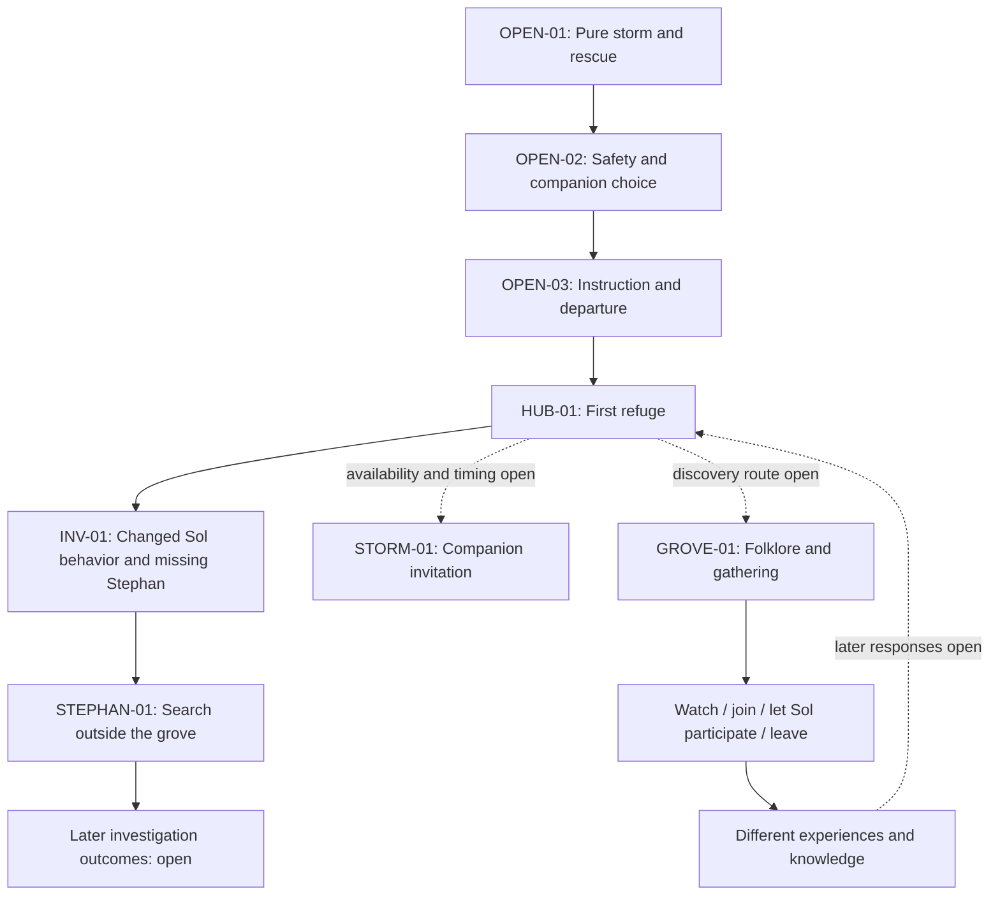

# SolHunter story development

Updated October 28, 2026.

## Authority and status

The [worldbuilding Bible](reference/SolHunter_Worldbuilding_Bible.md) governs
design. This document organizes story development under that authority; it does
not replace the Bible or the [project standard](PROJECT_STANDARD.md).

**Approved** identifies owner-selected direction. **Proposed** identifies an
authoring recommendation awaiting a decision. **Open** identifies an unanswered
question. Nothing here claims runtime implementation.

The story has many possible choices and outcomes. The structure below separates
events, entry conditions, choices, consequences and later responses instead of
assuming a single sequence of scenes. The approved story material is recorded
separately from the proposed structure used to develop it.

## Narrative foundation — approved

Vastra anchors authored places, ecology, human civilization, Sol relationships
and conflict. Each place needs its Vastra conditions, ecology, human relationship,
possibilities and continuity established.

Humans initially present Vastra as an opposing force to control and maintain.
The opening establishes genuine fear. Experiences with Sols can challenge the
player's interpretation of that fear. Sustainable ambient harvesting remains
safe; human dependence alone is not exploitation.

Most storms arise from the buildup of one affinity. Pure Vastra contains all
affinities together; pure storms are almost impossible to create by force.
Balanced circulation can instead produce a pure Vastra healing phenomenon.
Quantum Sols have exceptional synergy with the whole spectrum. Exact protection
limits and late-game immunity remain open.

Companionship centers on treating an individual well and understanding its
species. General interactions have species specialties. Sols can reveal rare
Sols, items and places, and trigger species-specific events. Repeatedly ignoring
clear discomfort gradually reduces optional cooperation; respectful treatment
can rebuild it. Mandatory play and routine relationship decay are excluded.

## Branching structure — proposed authoring model

Organize the adventure as connected story events within places and investigations.
An event can become available through several discoveries. Optional experiences
can run alongside an investigation without being disguised mandatory steps.

When paths reconnect, preserve what happened: who participated, what the player
learned, what they shared, and how people and Sols responded. A shared destination
does not imply identical dialogue, relationships or world conditions.

Use these fields when developing an event. Undecided values stay open rather
than becoming invented requirements.

| Field | Authoring purpose |
| --- | --- |
| Stable ID and title | Identify an event without tying it to a chapter number. |
| Status and authority | Separate approved content from proposals and open details. |
| Place and participants | Identify location, individuals and relevant species. |
| Availability | State prerequisites, alternative entry paths and recurrence conditions. |
| Player knowledge | Separate witnessed facts, testimony, folklore and interpretation. |
| Player choices | Include observation, participation, refusal or departure where appropriate. |
| Immediate results | Describe what each choice changes in the scene. |
| Persistent consequences | Describe enduring changes and later acknowledgments. |
| Interruption and return | Specify what happens if the player leaves or returns later. |
| Connections | Identify events that become available, change or remain independent. |
| Unresolved decisions | Keep missing design visible. |

Record choices separately from their consequences. Declining once, leaving an
event and permanently refusing a major story decision are different actions.
Temporary outcomes can change later without deleting the history that led there.

Distinguish these kinds of information when specifying later scenes:

- What actually happened in the world.
- What the player witnessed or was told.
- What an NPC knows or believes.
- What a Sol experienced and how it responded.
- What remains available, changed, deferred or permanently closed.

This is an authoring framework, not a save schema or an approved new relationship
formula. Recurrence schedules, mutually exclusive outcomes and irreversible
decisions must be established per event.

### Signals for future writing

Use these explicit markers in drafts and event notes:

- `[CONFIRMED]`: an owner decision or established Bible fact, with its source.
- `[SUGGESTED]`: a proposed scene, character detail or outcome awaiting selection.
- `[IMPLIED]`: a plausible connection inferred from confirmed material; not canon.
- `[ASK Q-xx]`: consult the question register before deciding the affected detail.
- `[DEFERRED]`: retain for later work without making it an early-story dependency.

When an author reaches an `[ASK]` marker, ask through the interactive questionnaire
before writing that answer as fact. Continue independent writing that does not
depend on it. Group related questions and consult existing decisions first; do
not reopen settled choices. Suggestions can be developed for review if clearly
marked, but silence or a plausible implication is not approval.

The register is a set of authoring triggers, not a requirement to ask every
question immediately. Preserve unanswered questions until their scene or system
is actually being developed. Add a new marker when a new consequential gap arises.

## Current connections

This map organizes approved relationships. Arrows show narrative connections;
they do not approve exact unlock conditions or force all experiences into order.

The order of the small-storm lesson, grove discovery and investigation branches
relative to one another is open. The grove's first visit does not advance the
search for Stephan. Do not require grove participation to resolve his search
without a new owner decision.

## Event outlines

### OPEN-01 — The pure storm

**Approved:** The player wakes in a major pure Vastra storm. Escape teaches
movement and sprinting. Three Sols guide the player to safety, establishing
unease, mystery and fear of Vastra.

**Continuity:** One of these same individual rescuers can become the starter.

**Open:** Opening location, rescue species, player background, storm origin,
failure/checkpoint rules and the detailed escape sequence.

**Additional confirmed presentation:** The storm is uncanny and beautiful as well
as threatening. Of the three rescuers, one scouts ahead, one stays beside the
player and one watches the rear. Their personalities are distinct; species and
exact gestures are not selected. Source: the
[Vastra presentation decision](decisions/2026-10-28-vastra-combat-and-restoration.md).

**Authoring signals:** `[ASK Q-01]` before explaining the player's arrival or the
storm's origin; `[ASK Q-02]` before assigning rescuer species; `[ASK Q-03]` before
writing damage, incapacitation or a restart. `[IMPLIED]` The rescuers' differing
roles offer ways to recognize them during later selection; no recognition
interaction is approved yet.

### OPEN-02 — Choosing a companion

**Approved:** The rescuers left their NPC owner mysteriously to save the player.
After escape, that owner permits keeping one. Interaction-led bonding precedes
explicit confirmation. Preserve the chosen individual's identity.

**Open:** NPC identity, specific interactions, selection staging, transfer terms
and what happens before the player confirms a choice.

**Authoring signals:** `[ASK Q-04]` before naming the NPC or writing ownership
transfer terms. `[ASK Q-05]` before choosing the bonding interactions or outcomes
of postponing selection. The confirmed starter is an actual rescuer, not a new
individual generated after selection. A Seal never establishes affection by itself.

### OPEN-03 — Preparing to travel

**Approved:** The NPC provides the first protective mask, basic instruction and
a teaching battle before the journey to the first refuge. The mask supports
basic exposure; Sol protection enables deeper passage.

**Open:** Lesson content, battle setup, travel route and exact exposure limits.

**Authoring signals:** `[ASK Q-06]` before specifying the teaching battle's
opponent, rewards or loss handling. `[ASK Q-07]` before assigning mask protection
limits. Do not introduce stamina, oxygen, filter replacement or immunity merely
to fill an unwritten tutorial step.

### HUB-01 — The first refuge

**Approved:** A concrete local problem leads toward a larger mystery. Local Sol
behavior has changed, alarming residents, and Stephan has not returned. These
are connected elements of one investigation.

**Available early play:** Starting-zone exploration, basic battles and quests
teaching basic mechanics remain available before accepting the storm invitation.

**Open:** Refuge identity and residents, exact testimony, basic quests and the
larger mystery. The approved initial investigation appears under STEPHAN-01.

**Additional confirmed presentation:** Protective infrastructure demonstrates
civilization's dependence on Vastra and visibly regulates incoming currents.
Human order and living wilderness contrast along the route. The refuge's name,
layout, equipment and sounds remain open.

**Authoring signals:** `[ASK Q-08]` before naming residents or fixing their roles;
`[ASK Q-09]` before creating investigation clues or explaining the larger mystery.
`[SUGGESTED]` Household folklore could provide different leads from the same
observed departures; the tellers and information they offer are not approved.

### STORM-01 — Listening to the companion

**Approved:** After the frightening opening, a smaller forming storm matches
the starter's randomly assigned individual affinity. The Sol approaches and
offers to show that it can protect the player. Its intention relates to why it
chose the player, while the deeper explanation stays ambiguous.

| Player choice | Approved immediate direction | Still open |
| --- | --- | --- |
| Explicitly agree to follow | The Sol accompanies/protects the player; Vastra visibly flows around both. | Distance, duration, controls and exact protection behavior. |
| Decline or back away | The demonstration is not immediately forced. | Repeat invitations and the Sol's response. |
| Continue other starting activities | Basic exploration, battles and teaching quests remain available. | Specific activities and how later storm barriers are introduced. |

Storms eventually limit further travel until the player learns the mechanic.
Matching affinity is required for ordinary Sol storm protection, with Quantum's
spectrum-wide exception still needing exact limits. No universal immunity is
established by completing this scene.

**Authoring signals:** `[ASK Q-07]` for protection boundaries and Quantum's
exception; `[ASK Q-10]` for refusal, repeat invitations and route barriers.
`[IMPLIED]` This scene can challenge fear established by the opening without
proving all storms safe. Its exact timing relative to refuge arrival is open.

### GROVE-01 — A place of renewal

**Approved place:** An ancient grove reached by following Sols away from familiar
paths. The companion leads toward a gathering of its species, whose individuals
have different affinities.

**Folklore:** Sols fall silent and leave familiar paths. Some households say they
are being lured away; others say they answer a place of renewal. The latter
preserve a quiet vigil without fully understanding its meaning.

**Phenomenon:** A recurring natural event seldom witnessed or understood by
humans. Different affinities circulate in balance, producing pure Vastra healing
that visibly restores the habitat and living beings present.

**Approved scene:** Sols settle among old roots. Visible affinity currents
circulate through the clearing. The companion joins, then turns back and waits
for agreement. If invited participation is accepted, the player walks into the
clearing under their own control beside the Sol. Damaged leaves recover and a
weary Sol relaxes. The companion settles beside the player in unfamiliar comfort.
The player can stay or step away.

| Player choice | Approved experience | Consequences still to author |
| --- | --- | --- |
| Watch quietly | Witness the healing from the edge; observation is meaningful. | Exact discoveries and journal treatment. |
| Join when invited | Experience the circulation beside the companion. | Specific shared responses and later acknowledgment. |
| Let the Sol participate independently | The Sol can participate without requiring the player to join. | Companion staging and what the player learns. |
| Leave | The natural event continues without needing the player. | Later return conditions and whether another gathering can be witnessed. |

**Boundary:** Neither Stephan nor a search-advancing trace appears during this
first grove visit. It remains a Sol-focused discovery.

**Open:** Species, invitation details, recurrence interval, mechanical healing,
later local changes, and what the player can tell people afterward. Returning
places should reflect changes in inhabitants, Sol behavior and local conditions;
the grove's particular return states are not yet selected.

**Authoring signals:** `[ASK Q-11]` before making the grove fixed, seed-placed or
necessary for progression; `[ASK Q-12]` before assigning species and recurrence;
`[ASK Q-13]` before assigning journal rewards, healing values or bond changes;
`[ASK Q-14]` before writing later visits or disclosures to residents.

`[IMPLIED]` The two household traditions may preserve different fragments of
the same history. Neither tradition's origin, accuracy or moral authority has
been decided. `[SUGGESTED]` Hearing the warning before seeing the grove could
make its healing surprising; no mandatory testimony order is approved.

### STEPHAN-01 — The independent investigation

**Approved:** Stephan pursued an investigation independently and has not
returned. He is unfamiliar to the player, already questions the accepted human
view of Vastra, and becomes a rival whose journey parallels the protagonist's
after they meet. Advance his search outside the first grove visit.

#### Refuge investigation and first meeting — approved October 28

Sols leave before the refuge's instruments detect anything unusual. Residents
fear approaching danger; someone has begun shutting gates to keep familiar Sols
inside. Stephan suspects the readings capture only part of what is happening
and follows Sol behavior beyond the maintained routes. The player's companion
responds to something along his route.

The player finds Stephan safe on an ordinary wilderness trail where wild Sols
approach a particular stretch, hesitate and turn back. Nothing about the place
looks significant at first. He has spent hours watching. His own companion
refuses to cross too; he respects its warning but is frustrated that he cannot
understand it. The player's companion notices the same boundary and responds
differently. Stephan notices immediately, giving them a shared mystery and a
reason to investigate together before their rivalry develops.

The approved meeting replaces the earlier shelter suggestion. Do not stage it
in an abandoned research center or facility. The first grove visit stays separate
from Stephan's search.

**Approved companion response:** The player's Sol hesitates, then follows the
edge of the boundary, stopping to listen at different points. It checks back
toward the player without crossing. What it senses remains open. Stephan's exact
dialogue and his own companion's subsequent response remain proposed.

**Open:** The boundary's cause, what the companion senses, the
search clues leading to Stephan, the instruments' details, resident identities,
Stephan's background and companion species, and the subsequent rivalry.

#### Proposed Stephan concept — awaiting selection

Stephan is a capable, observant young Solhunter who dislikes having questions
dismissed. He notices when human explanations fail to account for Sol behavior.
He follows evidence without waiting for permission, but can become absorbed
enough to neglect people expecting him back.

The proposed parallel is two people questioning inherited beliefs through
different experiences. Stephan tests patterns; the protagonist has opportunities
to learn through companionship. Neither approach is exclusive, and Stephan can
sometimes reach a sound conclusion first. Their rivalry could involve discovery,
understanding Sols, reaching places and occasional battles. His longer arc could
explore uncertainty and responsibility to others.

The proposed background and longer arc above remain unapproved; the selected
investigation and trail meeting are recorded separately above.

**Additional suggestion retained from the character discussion:** Stephan's Sol
could be comfortable interrupting his concentration when he overlooks something.
His impatience could emerge through those interactions without making him cruel.
His age, partner species and this additional interaction remain unapproved.

**Authoring signals:** `[ASK Q-15]` before adopting unselected personality,
background or further companion-response details; `[ASK Q-09]` for the boundary's cause
and search clues; `[ASK Q-16]` before writing a rival battle, recurring challenge or
longer character outcome. `[IMPLIED]` Already questioning human beliefs does
not make Stephan correct, an antagonist, or the player's ideological opposite.

## Later branch already established in the Bible

The starter's legendary request creates a major lasting choice. Refusal
permanently forfeits that starter's legendary manifestation in the save, while
victory remains possible through a harder path. Relationship and story
consequences endure; a changed but enduring relationship is the approved first
expression to explore. The original starter cannot die.

Exact request scenes, acceptance outcomes, refusal consequences, warnings and
connections to the early exploration story remain open. Do not turn early
storm-invitation refusal into this permanent legendary refusal. Later in-game
collection or separation must not bypass the established legendary lockout.

**Authoring signals:** `[ASK Q-18]` for the antagonist's operational plan and
connection to this choice; `[ASK Q-19]` before writing either climax branch,
memory continuity, separation or ending variations. Early optional refusals
must retain their own meaning and cannot silently select the permanent branch.

## Wider story facts and continuity

These facts come from the Bible. They constrain future writing without requiring
every subject to be revealed in the first refuge story.

### World, inhabitants and presentation

- `[CONFIRMED]` SolHunter is a dark-fantasy creature-collecting tactical RPG.
  Exploration, collection/development and combat are equal pillars. Region One
  aims to be a complete adventure, with approximately 151 roster entries and a
  level-55 cap; this is scope, not an authored species list.
- `[CONFIRMED]` Settlements depend on Vastra-powered infrastructure, barriers and
  equipment. Solhunters are socially significant because they interact with
  creatures ordinary people often fear. Individual hunters have different values.
- `[CONFIRMED]` Authored settlements, landmarks, routes and story locations coexist
  with procedural wilderness. Fixed story anchors and seed-placed optional
  discoveries are approved; exact placements are not.
- `[CONFIRMED]` Sols are physical living individuals with memories, personalities,
  instincts and relationships. Aggression can be territorial protection rather
  than cruelty. Avoidant, neutral and assertive behavior should be readable.
- `[CONFIRMED]` Species/lineage class and independently assigned individual affinity
  are separate. Ordinary affinities are Fire, Water, Earth, Air and Lightning;
  Void and Spectral are rare, Quantum the rarest. Rarity does not mean greater
  overall power. Pure Vastra is the whole spectrum, not a ninth individual affinity.
- `[CONFIRMED]` The current final presentation direction is full 3D with strong
  stylized shapes and distinctive silhouettes. Sol designs are original dark
  fantasy beings, often mythic rather than literal animals. Small Sols anchor
  scale; humans are normally smaller than small Sols. Large Sols occupy 3×3 tiles.
  Exact dimensions and final creature designs remain open.
- `[CONFIRMED]` A first journal discovery pairs observed Sol behavior with a useful
  habitat clue. People can also contribute journal knowledge. Exact journal and
  lore triggers are not established, nor is this discovery's identity with the
  storm invitation or grove event. `[ASK Q-13]` before merging those moments.
- `[CONFIRMED]` Players and Sols are customizable. Sol customization primarily
  expresses combat development, such as bigger flames, with occasional cosmetics.
  `[ASK Q-17]` before assigning particular unlocks, costs or rewards.

### Care, Seals and ordinary evolution

- `[CONFIRMED]` Seals are paper-like magical artifacts holding an actual Sol
  through a soul contract. The individual is not recreated as a copy. Identity
  and memories persist through transfer; transfer circumstances matter.
- `[CONFIRMED]` Contractual possession does not guarantee trust, affection or
  obedience. Advanced resistance/escape behavior remains deferred. Do not infer
  implemented command refusal from the approved optional-cooperation response.
- `[CONFIRMED]` Battle capture and deliberate peaceful acquisition are established
  approaches. The standard peaceful route excludes aggressive Sols under current
  design. Capture formulas and transfer bonuses remain provisional; ordinary
  narrative scenes must not invent those numbers.
- `[CONFIRMED]` Species knowledge is learned from readable behavior, discoveries
  and people. Repeatedly pushing through clear distress, interrupting chosen rest
  or forcing rejected interaction are initial, revisable poor-treatment examples.
  The gradual response is recoverable and does not punish a first misunderstanding.
- `[CONFIRMED]` Bond development centers on species-specific care, shared ordeals
  and consistent choices. Ordinary evolution is mutual: the player offers and
  the Sol must be willing. Maximum bond is not required before evolution.
- `[CONFIRMED]` Ordinary transformation changes the relationship almost like a
  reset, retaining a personality core and recoverable memories. New instincts
  and needs limit advanced teamwork until trust is rebuilt. Missed earlier-form
  bond milestones can be recovered through difficult later memory recovery.
  Unique relationship moments and teamwork matter among the greatest rewards.
  `[ASK Q-17]` for actual activities, willingness, milestones and consequences.

### Vastra, harm and recovery

- `[CONFIRMED]` Concentration and overload are separate; rich Vastra can be healthy.
  Sustainable ambient harvesting is safe. Unsustainable human disruption and
  aggressive Vastra-powered abilities can generate positive overload.
- `[CONFIRMED]` Healing abilities can reduce overload even at full health and
  create negative restorative conditions. Both signs relax toward zero. Natural
  Sol activity supports equilibrium rather than independently originating overload.
- `[CONFIRMED]` Ordinary currents are subtle distortions with occasional luminous
  strands; healthy flow is smooth, disturbed flow tangled with erratic surges.
  A companion notices the first ordinary-current clue; its exact content is open.
- `[CONFIRMED]` Procedural storms use a contiguous eligible 3×3 footprint with
  probabilistic formation. Authored narrative storms can bypass that requirement.
  Ordinary rain/day-night presentation does not establish a Vastra storm.
- `[CONFIRMED]` Ordinary combat defeat is exhaustion, not death. Natural Sol death
  is peaceful/restorative; unjust death can release destructive energy. Intent
  and circumstances matter. Predation, accident and self-defense classifications
  remain open. `[ASK Q-18]` before using an exceptional death in a plot.
- `[CONFIRMED]` Vastra's ultimate origin is not universally known. Scholars can
  disagree; regional names and local folklore can differ. Whether Vastra is
  conscious remains intentionally ambiguous. Do not settle it through omniscient
  narration or a character's unchallenged assertion.
- `[IMPLIED]` The grove and negative ecological overload both involve restoration,
  but they are not yet established as identical mechanisms. `[ASK Q-12]` before
  assigning simulation rules to the grove.

### Main conflict, antagonist and ending

- `[CONFIRMED]` The central conflict concerns humanity's relationship with Sols
  and nature, including the capacity to exploit and destabilize living systems.
- `[CONFIRMED]` The established antagonist concept is an extremist seeking to
  eradicate humanity, using catastrophic releases from unjust Sol deaths toward
  a world-altering explosion/reset. They understand Vastra technically; their
  contradiction is harming nature while claiming to save it.
- `[OPEN — ASK Q-18]` Antagonist identity, history, organization and exact method.
  The near-impossibility of forcing a pure storm does not authorize equating that
  storm with the antagonist's planned release. The opening storm's cause is open.
- `[CONFIRMED]` Ideological tensions emerge through individuals and consequences.
  Control, autonomy, coexistence and restoration are provisional orientations,
  not four mandatory factions. Characters can hold overlapping values.
- `[CONFIRMED]` Region One has one main ending with meaningful variations: humanity
  survives through responsible coexistence. Many branching events and outcomes
  can lead there; they do not require wholly unrelated final endings.
- `[CONFIRMED]` The starter and its legendary manifestation are distinct individuals.
  The starter is a vessel/exit point; Vastra is the medium. Ascension is not
  ordinary evolution. The vessel's affinity is preserved, and only one of each
  legendary individual exists within a save's reality.
- `[CONFIRMED]` Accepting the starter's request permits manifestation. Advanced
  separation may later preserve the original's identity; timing and requirements
  remain future design. Legendary memory/relationship inheritance is unresolved.
- `[DEFERRED]` A future major release reveals alternate versions of the legendary
  Solhunter across realities. This is not an approved early-game explanation of
  the rescue. Advanced form shifting, postgame collection, a superboss and online
  systems remain later work; they cannot undo the permanent refusal consequence.

## Consequence notes — proposed, not a runtime schema

Track event history and current circumstances separately when drafting branches.
Candidate records below identify differences later scenes may need to recognize;
their exact effects require decisions.

| Story subject | Concrete distinction to preserve | Suggested later use / question |
| --- | --- | --- |
| Starter | Which rescuer became the companion; individual affinity and identity. | Recognize shared history; never substitute a generic starter. |
| Storm invitation | Offered, declined, later accepted, demonstration experienced. | Different repeat invitations; `[ASK Q-10]`. |
| Folklore | Which accounts were heard, from whom, and what was witnessed firsthand. | Dialogue distinguishes testimony from evidence; `[ASK Q-14]`. |
| Grove | Visited, watched, joined, Sol participated independently, departed. | Acknowledge experience without ranking observation as failure; `[ASK Q-13]`. |
| Disclosure | What was told to whom, if disclosure becomes an option. | Recipient-specific knowledge; `[ASK Q-14]`. |
| Stephan | Search evidence, first meeting and subsequent encounters. | Rival continuity; `[ASK Q-09]`, `[ASK Q-15]`, `[ASK Q-16]`. |
| Treatment | Clear discomfort, repeated disregard, respectful recovery. | Optional cooperation responds gradually; `[ASK Q-17]`. |
| Place | Inhabitants, Sol behavior and local conditions across visits. | Meaningful continuity; `[ASK Q-14]`. |
| Evolution | Form history, memories, willingness and rebuilt cooperation. | Species-specific relationship scenes; `[ASK Q-17]`. |
| Legendary choice | Decision, permanent refusal lockout and subsequent outcomes. | Ending variations without erased consequences; `[ASK Q-19]`. |

Do not assume leaving a scene is hostility, declining an invitation is mistreatment,
or discovering evidence automatically informs every NPC. These consequences have
not been approved. Timing-sensitive failure, permanent losses and mutually
exclusive rewards require explicit authoring decisions.

## Question register

Each row says when to ask. Resolved answers should update the affected outline,
retain relevant history and cite the owner decision/Bible rather than leave
contradictory open notes behind.

| Signal | Ask when developing | Question to resolve |
| --- | --- | --- |
| Q-01 | Opening context or explanation | Who is the protagonist before waking, where are they, and what can be revealed about the storm's cause? |
| Q-02 | Rescuer casting | Which three species/individuals rescue the player, and what distinguishes each personality? |
| Q-03 | Escape gameplay | What does exposure do, how does failure work, and where can the player retry? |
| Q-04 | Rescuer owner and transfer | Who owns the rescuers, why permit the choice, and what does transfer involve? |
| Q-05 | Companion selection | Which interactions establish the choice, and what happens if confirmation is postponed? |
| Q-06 | Teaching battle and early quests | Who participates, what is taught, and how are loss, retry and rewards handled? Which basic quests are offered? |
| Q-07 | Protection specification | How do mask exposure, matching Sol protection and Quantum synergy work; what limits pure-storm passage? |
| Q-08 | Refuge cast and location | What is the refuge called, who lives there, and who provides each account or task? |
| Q-09 | Investigation | What causes the trail boundary and early Sol departures, and which clues lead the player to Stephan outside the grove? |
| Q-10 | Storm invitation branches | When is it offered, what follows refusal, how does it recur, and which routes eventually require the lesson? |
| Q-11 | Placement and dependencies | Which sites are fixed or seed-placed, and which event orders or routes must remain possible? |
| Q-12 | Grove ecology | Which species gathers, what conditions permit balanced circulation, when does it recur, and how does it relate to other restoration? |
| Q-13 | Discovery and participation | What does each gathering choice reveal, how is it recorded, and are any recovery or relationship effects granted? |
| Q-14 | Return visits and disclosure | What changes later, what can the player share, and how do particular residents respond? |
| Q-15 | Stephan's introduction | What are Stephan's background and companion species, and how do he and his companion respond to the player's Sol listening along the edge? |
| Q-16 | Rival progression | What encounters develop rivalry, how can choices affect it, and what are Stephan's possible outcomes? |
| Q-17 | Companion development | What species-specific care, signals, customization, teamwork, evolution and memory-recovery scenes exist, with what consequences? |
| Q-18 | Main antagonist plot | Who is responsible, what is the plan, how is it revealed, and how do new storm rules constrain it? |
| Q-19 | Climax and ending branches | What exactly is requested, what is communicated before commitment, and what persists on acceptance/refusal? |
| Q-20 | New authored place or event | What are its Vastra conditions, ecology, human relationship, choices and continuity? Which details need owner selection? |

## Suggested location and event backlog

These are preserved brainstorming candidates, not approved destinations or quests.
Apply `[ASK Q-20]` before selecting or developing one as story content. Vastra
must be integrated across categories rather than isolated into a single category.

| Area | Suggested places | Suggested event possibilities |
| --- | --- | --- |
| Nature | Nesting grounds, migration crossings, flooded hollows, guardian territories. | Habitat changes, seasonal gatherings, territorial disputes, unusual species cooperation. |
| People | Roadside shelters, small holdings, travelling camps, remote workshops. | Passage requests, a missing Sol, disagreement about wildlife. |
| Infrastructure | Barrier stations, harvesting sites, abandoned settlements. | Protection failures, habitat conflicts, dependence and sustainable use. |
| History and folklore | Ruins, memorials, forgotten roads, sealed passages. | Contradictory accounts, repeated sightings, evidence that changes a local interpretation. |
| Vastra phenomena | Concentration sites, disturbed territories, restoration sites, storm shelters. | Unusual currents, recovery, disturbance, Sol responses preceding human understanding. |
| Sol life | Resting places, feeding grounds, dens, social gathering sites. | Familiarity with an individual, injury, guardianship, social behavior and species needs. |

`[SUGGESTED]` Quests can connect places across these categories; some discoveries
can remain valuable without a task or material reward. No specific quest list,
economy, seasonal system or event-generation mechanic is approved by this backlog.

## Sources and review notes

- [Worldbuilding Bible](reference/SolHunter_Worldbuilding_Bible.md): central vision,
  world exploration, Vastra, Sol identity and evolution, Seals, story/antagonist,
  legendary choices, and the October 28 questionnaire decisions appended there.
- [Opening and companionship decision](decisions/2026-10-28-opening-companionship-and-consequences.md):
  rescue sequence, instruction, first discovery and lasting refusal consequences.
- [Vastra combat/restoration decision](decisions/2026-10-28-vastra-combat-and-restoration.md):
  current presentation, rescuer roles, refuge regulation and signed overload.
- Current owner conversation: branching story structure and explicit request to
  preserve concrete decisions, suggested/implied notes and question signals.

This document records story design. Existing playable refuge/waystone content is
a development baseline, not proof these authored campaign events are delivered.
Consult the [mechanics reference](mechanics-reference.md) before implementing
non-generation mechanics; record conflicts rather than inventing replacements.

## Next authoring decisions

- Select or revise Stephan's proposed character concept and first meeting.
- Define the investigation's clues and choices without using the first grove
  visit as a search step.
- Develop refuge inhabitants and their different folklore interpretations.
- Specify discoveries and later responses for each gathering choice.
- Establish repeat visits and what the player can share about the grove.
- Expand the location/event catalogue across nature, people, history, quests and
  infrastructure, with Vastra integrated throughout.

Keep fixed story anchors alongside seed-placed optional discoveries. Their exact
placement guarantees and progression conditions remain open; Godot remains the
world-generation authority.
